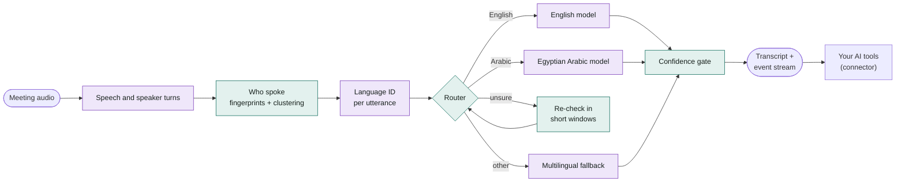

<p align="center">
  <picture>
    <source media="(prefers-color-scheme: dark)" srcset="assets/logo-dark.svg">
    
  </picture>
</p>

<h1 align="center">meeting-harness</h1>

<p align="center">
  <strong>Multilingual, multi-speaker meeting transcription built from small models that each do one job, routed by plain rules.</strong><br>
  On-device. English and Egyptian Arabic first, including both in one sentence.
</p>

<p align="center">
  <a href="https://github.com/MohamedMostafaSal/meeting-harness/actions/workflows/swift.yml"></a>
  <a href="https://github.com/MohamedMostafaSal/meeting-harness/actions/workflows/web.yml"></a>
  <a href="LICENSE"></a>
  
</p>

<p align="center">
  <a href="https://mohamedmostafasal.github.io/meeting-harness/"><strong>Try the web prototype</strong></a> ·
  <a href="docs/design.md">Design</a> ·
  <a href="#status">Status</a> ·
  <a href="CONTRIBUTING.md">Contributing</a>
</p>

---

Most transcription apps send the whole meeting through one large model and hope it copes with several speakers, two languages, people talking over each other and long silences. When it fails, you can't tell which part failed.

**meeting-harness splits the job into narrow questions.** Is anyone speaking? Who? Which language? What did they say? Each question goes to a small model that is already good at it. Deterministic code makes every decision in between, so each step can be tested, measured and swapped on its own.

## What it fixes

| Common problem | What the harness does |
|---|---|
| Assumes one language per meeting | Detects the language of every utterance and routes it to a model for that language |
| Arabic and English mixed in one sentence | Re-checks ambiguous speech in short windows and splits it at the language boundary |
| Speaker labels drift halfway through | Clusters voice fingerprints across the whole meeting; enrolled voices keep their names |
| People talking over each other get merged | Flags overlapping speech instead of inventing a speaker for it |
| Invented text during silence ("thanks for watching") | Silence never reaches speech-to-text; known hallucinations are flagged |
| Black box | Every line records which model wrote it and how confident the routing was |
| Cloud-only | Everything runs on the phone. No audio leaves it. |

## How it works



<sub>Purple steps run a small model. Green steps are deterministic code (the fingerprints come from a model; the clustering and naming are code). The full list of pillars is in the <a href="docs/design.md">design doc</a>.</sub>

The app is the ears, not the brain. It produces the transcript and publishes it as an append-only event stream (`segment.final`, `speaker.renamed`, …), so tools like Claude can follow the meeting. Summaries and action items happen there, not in the app.

## Example

Real output from the web prototype's CI run, which joins two speeches by two different people:

```
S1  00:00  en  And so, my fellow Americans ask not what your country can do for you,
               ask what you can do for your country.
S2  00:13  en  I have a dream. But one day...
S2  00:18  en  This nation will rise up, live out the true meaning of its creed.
```

And the routing for a mixed Egyptian Arabic / English sentence, from the Swift core's demo (scripted models):

```
Sara  00:12  ar  خلينا نبدأ بالـ        ← Egyptian Arabic model
Sara  00:13  en  quarterly review      ← English model, same speaker
```

## Try it

**Web prototype** (iPhone Safari or any modern browser): <https://mohamedmostafasal.github.io/meeting-harness/>
Record or upload a meeting, optionally enroll your voice, and get a transcript with speakers, languages and the router's reasoning. Models download once (about 220 MB for the Light set) and are cached.

**Swift core** (macOS or Linux):

```sh
swift test               # 39 tests: schema, router, speakers, pipeline, metrics
swift run harness-demo   # the mixed-language demo meeting, as Markdown and JSON Lines
```

**Web prototype locally:**

```sh
cd web
npm install && npm test  # logic and pipeline tests with scripted models
npm run smoke            # real models on two recorded speeches (needs internet)
python3 -m http.server   # then open http://localhost:8000
```

## Status

Proof of concept. What exists and what's next:

- [x] Design: pillars, routing rules, connector contract ([docs/design.md](docs/design.md))
- [x] Swift harness core: transcript schema, event stream, router, speaker clustering and enrollment, Arabic-aware accuracy metrics
- [x] Web prototype running real models in the browser, tested end to end in CI
- [ ] Reference recordings: Egyptian Arabic, English and mixed meetings with checked transcripts
- [ ] Port the prototype's lessons to the Swift core (decide who spoke before transcribing)
- [ ] iOS app with Core ML models
- [ ] An Egyptian Arabic speech-to-text model that runs on device
- [ ] Connector to Claude, then live captions

## Repository

```
Sources/HarnessCore/     Swift: the deterministic harness (schema, router, speakers, pipeline, metrics)
Sources/HarnessTesting/  Swift: scripted stand-in models and the demo meeting
Tests/                   Swift tests
web/                     Web prototype: the same pipeline in JavaScript with real models
docs/design.md           Full design: pillars, decisions, open questions, lessons learned
```

## Contributing

Recordings of real mixed-language meetings (with consent) and transcription problems are the most useful contributions right now. See [CONTRIBUTING.md](CONTRIBUTING.md).

## Acknowledgements

The web prototype downloads these models from Hugging Face at runtime; none are bundled in this repository. See each model card for its license.

- [Whisper](https://github.com/openai/whisper) by OpenAI, via [Xenova's ONNX exports](https://huggingface.co/Xenova/whisper-base)
- [pyannote segmentation 3.0](https://huggingface.co/onnx-community/pyannote-segmentation-3.0) by pyannote
- [WavLM base plus SV](https://huggingface.co/Xenova/wavlm-base-plus-sv) by Microsoft
- [Transformers.js](https://github.com/huggingface/transformers.js) and ONNX Runtime Web, which run them in the browser

## License

[MIT](LICENSE) © 2026 The meeting-harness contributors
